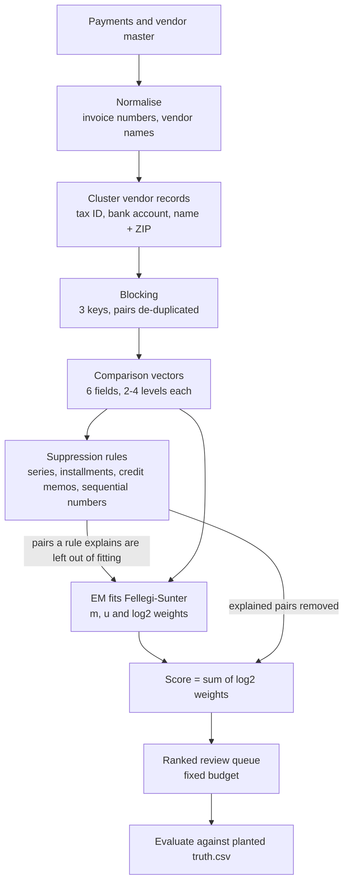

# paidtwice

[](https://github.com/SlateGitOrg/paidtwice/actions/workflows/ci.yml)


paidtwice finds duplicate vendor payments in an accounts payable ledger without labelled examples. It normalises invoice numbers and vendor names, clusters duplicate vendor records, blocks the 450 million possible payment pairs down to about 54,000, learns Fellegi-Sunter match weights by EM from those pairs, removes legitimate look-alikes (monthly rent, installments, credit memo re-bills) with explicit rules, and ranks what is left into a fixed-size review queue. The data is synthetic and seeded, so the ranking can be scored against planted duplicates and planted look-alikes.

## The problem

A public university's accounts payable office pays about 15,000 invoices a year from 4,000 vendor records, keyed by staff in many departments, some from scanned documents. Duplicate payments get through when an invoice number differs by a typo (`INV-00123` against `INV00123`, `1O45` against `1045`), when a vendor exists twice in the master file, or when an invoice is paid by check and again on a purchasing card. An exact-match duplicate report misses most of these. A fuzzy one flags every month of rent and every installment, and the analyst, who can review a few hundred pairs, stops trusting it. The hard part is not finding look-alikes. It is rejecting the legitimate ones and ranking the rest.

## How it works



1. **Normalise.** Invoice numbers are uppercased, stripped of punctuation and spaces, have OCR-confusable letters (`O`->0, `I`/`L`->1, `S`->5, `B`->8, `Z`->2) rewritten only where they touch a digit, and lose the leading zeros of every digit run. An installment suffix (`-1` to `-12`, `/2`) is split off, and credit memos are recognised by a `CM` prefix or a negative amount. Vendor names lose case, punctuation, leading articles and legal suffixes.
2. **Vendor clusters.** Records are joined with union-find when they share a tax ID, a bank account, or a normalised name and ZIP.
3. **Blocking.** A pair is a candidate if the payments share a vendor cluster and an absolute amount rounded to $1, or an exact amount with invoice dates at most 120 days apart, or a canonical invoice number (across vendors).
4. **Comparison vector.** Per pair: invoice number (canonical equal / Damerau-Levenshtein 1 / 2 / different), amount (exact / within 0.5% / different), date gap (<= 10 / <= 60 / > 60 days), vendor (same id / same cluster / different), purchase order (same / missing / different) and payment method (same / different). Damerau-Levenshtein is the optimal-string-alignment variant, implemented in `distance.py`.
5. **Fit.** EM learns the match probability `m`, the non-match probability `u` and the prior for each level under conditional independence, starting from a documented initialisation and stopping at a tolerance of 1e-9.
6. **Suppress and score.** Each rule carries a reason code. Pairs a rule explains are dropped before ranking. The remaining pairs are ranked by the sum of `log2(m/u)` over their levels, then by amount at risk.
7. **Evaluate.** `truth.csv` is written by the generator and read only by `evaluate` (and the tests).

## Quick start

```bash
uv venv .venv
uv pip install --python .venv/bin/python -e ".[dev]"

.venv/bin/paidtwice generate --data data --seed 42   # vendors.csv, payments.csv, truth.csv
.venv/bin/paidtwice vendors --data data              # vendor_clusters.csv
.venv/bin/paidtwice candidates --data data           # candidates.csv, blocking_report.json
.venv/bin/paidtwice fit --data data                  # model.json, prints m, u, log2 weights
.venv/bin/paidtwice score --data data --budget 200   # queue.csv, suppressed.csv
.venv/bin/paidtwice score --data data --no-suppress  # queue_no_suppress.csv (ablation)
.venv/bin/paidtwice evaluate --data data             # evaluation.md
```

Any Python 3.11 or newer works. `pip install -e ".[dev]"` and `paidtwice ...` do the same without uv.

## Example output

The data is synthetic: 4,000 vendor records (120 of them second or third records of 100 vendors, sharing a tax ID or bank account), 30,000 payments over two fiscal years, 180 planted duplicate payments in six mechanisms, and three kinds of legitimate look-alike (300 recurring monthly payments across 25 vendors, 80 equal installment pairs, 60 credit memo plus re-bill triples). Output below is from `--seed 42`.

Blocking (`paidtwice candidates`):

```text
payments: 30,000   all pairs: 449,985,000
  block cluster_amount      2,084 pairs  (890 found only here)
  block amount_date        53,211 pairs  (52,017 found only here)
  block invoice_number        262 pairs  (7 found only here)
candidate pairs: 54,108 (0.0120% of all pairs, reduction ratio 0.999880)
```

Weights learned by EM (`paidtwice fit`). Read the amount rows as "no weight": see the design decisions. The `u` values are floored at about 1e-5 by the 0.5 pseudo-count.

```text
EM: 4 iterations, converged=True, pi=3.448e-03, training pairs=52,198 of 54,108 candidates
ordinal weights pooled for: amount
field   level                     m           u  log2 weight
invoice canonical_equal      0.8544    0.000010        16.44
invoice dl1                  0.1291    0.000010        13.71
invoice dl2                  0.0137    0.000010        10.48
invoice different            0.0028    0.999971        -8.51
amount  exact                1.0000    0.999981         0.00
amount  within_0.5pct        0.0000    0.000010         0.00
amount  different            0.0000    0.000010         0.00
date    le10d                0.3884    0.095358         2.03
date    le60d                0.5262    0.429426         0.29
date    gt60d                0.0854    0.475216        -2.48
vendor  same_id              0.8016    0.000010        16.35
vendor  same_cluster         0.1956    0.000029        12.73
vendor  different            0.0028    0.999962        -8.50
po      same                 0.4931    0.000010        15.65
po      missing              0.5041    0.647786        -0.36
po      different            0.0028    0.352204        -7.00
method  same                 0.8867    0.396422         1.16
method  different            0.1133    0.603578        -2.41
```

Suppression (`paidtwice score`): 1,910 of 54,108 candidate pairs are explained by a rule.

```text
  recurring_series      1,650 pairs
  installment_suffix       80 pairs
  credit_memo             120 pairs
  credit_memo_rebill       60 pairs
  sequential_invoice      275 pairs
```

Evaluation at a review budget of 200 (`paidtwice evaluate`):

| Metric | Value |
| --- | ---: |
| Planted duplicate payments | 180 |
| True duplicates in the queue | 180 |
| Precision at budget | 0.900 |
| Recall | 1.000 |
| Dollar recall | 1.000 |
| Blocking recall | 1.000 |

| Mechanism | Planted | Found | Recall |
| --- | ---: | ---: | ---: |
| check_and_pcard | 20 | 20 | 1.000 |
| digit_transposition | 25 | 25 | 1.000 |
| duplicate_vendor_record | 35 | 35 | 1.000 |
| exact_resubmission | 20 | 20 | 1.000 |
| ocr_confusable | 30 | 30 | 1.000 |
| punctuation_variant | 50 | 50 | 1.000 |

Legitimate look-alikes among the 200 queued pairs:

| Look-alike type | With suppression | Without suppression |
| --- | ---: | ---: |
| credit_memo | 0 | 16 |
| installment | 0 | 44 |
| recurring | 0 | 85 |
| total | 0 | 145 |

Without the rules, 145 of the 200 slots go to legitimate payments. The credit memo count without suppression comes from re-bill pairs (an invoice and its corrected re-bill); the memo-to-invoice pairs score lower because the memo's `CM-` number rarely matches its invoice's (the invoice level is `different` for 114 of the 120 pairs and `dl2` for the rest, and most have no PO to agree on), not because of the amount: the amount levels carry weight 0 (see the design decisions).

First ten rows of `queue.csv` (columns trimmed; all ten tie on score, so amount at risk orders them):

```text
rank  payment_a   payment_b   invoice_a     invoice_b      amount_a  score
   1  PAY-019582  PAY-019630  CYY-191793    CYY-L91793     7305.03   51.622
   2  PAY-005090  PAY-005362  ANF1834603    ANF18346O3     4933.50   51.622
   3  PAY-018717  PAY-018896  WHC-179349    WHC 179349     3962.07   51.622
   4  PAY-024160  PAY-024398  PAJ-1727663   paj001727663   3818.20   51.622
   5  PAY-015107  PAY-015441  XGY-1577430   xgy1577430     3568.56   51.622
   6  PAY-011207  PAY-011210  PNY.01913004  PNY1913004     3500.00   51.622
   7  PAY-012324  PAY-012395  JRC-1005404   JRC.001005404  2643.36   51.622
   8  PAY-019377  PAY-019378  CKH144Z909    CKH1442909     2227.96   51.622
   9  PAY-014751  PAY-015132  NKH652887     NKH6528B7      2219.15   51.622
  10  PAY-022242  PAY-022516  AGW1719433    AGW.001719433  1605.03   51.622
```

Every row also has `matched_levels` (for example `invoice=canonical_equal;amount=exact;date=le10d;vendor=same_id;po=same;method=same`), `reason_codes` (empty in the default queue; filled in `queue_no_suppress.csv` with the rules that would have removed the pair) and `amount_at_risk`, the smaller of the two absolute amounts.

## Design decisions

- **EM on blocked pairs, with rule-explained pairs left out of training.** Training on all candidates lets the 1,650 recurring-series pairs, which look like duplicates on every field but the invoice number, pull the match class toward "same vendor, same amount": `m` for an equal invoice number falls from 0.85 to 0.33 (measured with `fit_model(..., use_suppression=False)`) and the invoice weights get pooled. Leaving out the pairs a rule explains keeps the match class about duplicates. **The cost is that the weights depend on the rules, so `score --no-suppress` ablates ranking only: both queues use identical weights.** The with/without table above shows what the rules remove from the queue, not what a model trained without any rules would do. A population-level fit (candidates plus a weighted random sample of the pairs blocking discards) was tried first; it gave tiny, correct `u` values but latched onto "same vendor" as the match class, because vendor and invoice-number proximity are correlated among non-duplicates and conditional independence does not hold.
- **The amount carries essentially no weight.** Two of three blocks require equal amounts (the third, the cluster block, an amount equal to the dollar), so almost every candidate agrees on amount. EM sees only a handful of pairs at the `within_0.5pct` and `different` levels, their order contradicts the order of the levels, and the ordinal pooling flattens all three to a weight of 0.00 (see the table). The brief's amount levels (exact / within 0.5% / different) are therefore computed but do nothing in scoring. Amount matters only through blocking and through the amount-at-risk used for tie-breaking. A duplicate whose amount differs by more than a dollar is found only through the invoice-number block.
- **Rules are deterministic and carry reason codes.** An analyst can read why a pair was dropped (`suppressed.csv`), and the recurring-series rule only suppresses pairs at least 25 days apart, so rent paid twice in one month is still flagged. The trade-off is that a duplicate hidden inside a series is suppressed if it falls 25 or more days from another member; the rules do not look at the learned score. The credit memo rule needs the memo and its invoice to be candidates, so the first block compares absolute amounts: an invoice and the memo that cancels it share a block, and on the seeded data the rule suppresses 120 memo pairs (two per triple) next to 60 netted re-bill pairs.
- **OCR confusables only next to digits.** `BILL-STOCK` keeps its letters while `1O45` becomes `1045`. The cost is that a confusable at the edge of a purely alphabetic prefix is not repaired, and the installment pattern requires a digit in the base so that `INV-12` is not read as installment 12 of `INV`.
- **Vendor clusters are transitive.** Union-find chains records through any shared key, which finds a third record that shares nothing with the first. A shared aggregator bank account would merge unrelated vendors, so a real deployment should exclude known shared accounts.
- **Amount at risk is the smaller absolute amount.** It is the conservative overpayment when the two payments differ slightly (a card surcharge). Dollar recall uses the same definition on the planted pairs.

Two limits on how to read the evaluation:

- **Recall of 1.0 depends on the generator.** Outside the planted groups a synthetic vendor never bills the same dollar amount twice, and 92% of vendors put a vendor-specific three-letter prefix on their invoice numbers (the rest use bare numbers drawn from a wide range). Both choices make accidental coincidences on amount or invoice number rare, which a real ledger would not.
- **Precision is capped at 0.9.** Only 180 duplicates are planted and the budget is 200, so at least 20 queue slots hold something else. With seed 42 the 20 unplanted slots (ranks 181 to 200) score below zero: nearly all are payments to different vendors with different invoice numbers that share only a round amount and a date within 10 days. They are not look-alikes: with suppression the queue has no recurring, installment or credit memo pair.

## Testing

```bash
.venv/bin/python -m pytest -q
.venv/bin/python -m ruff check . && .venv/bin/python -m ruff format --check .
```

89 tests, all offline. Unit tests cover the canonicaliser, Damerau-Levenshtein distance, union-find clustering, each blocking key, each suppression rule on hand-built ledgers, and EM recovering a known mixture. Acceptance tests run the whole CLI once on the seeded data and assert: all 120 duplicate vendor records are clustered with their vendor and no two vendors merge; blocking keeps under 0.5% of pairs with recall of at least 0.98; `m(canonical invoice equal) > 0.8`, `u < 0.01` and strictly decreasing invoice weights; precision at least 0.85, recall at least 0.90 and dollar recall at least 0.95 at budget 200; recall of at least 0.80 for each mechanism; no recurring, installment or credit-memo pair in the suppressed queue, at least 20 in the unsuppressed one, and the credit memo rule firing on every seeded memo pair; and a byte-identical queue for the same seed.

## Project layout

```text
src/paidtwice/
  normalize.py    invoice-number and vendor-name canonicalisation
  distance.py     Damerau-Levenshtein (optimal string alignment)
  vendor_gen.py   synthetic vendor master with duplicate records
  generate.py     seeded payments, planted duplicates and look-alikes, truth.csv
  vendors.py      union-find vendor clustering
  data.py         file names and the prepared payment table
  candidates.py   blocking and the reduction report
  compare.py      comparison vectors and level definitions
  suppress.py     suppression rules and reason codes
  em.py           Fellegi-Sunter EM, model file, ordinal pooling
  fit.py          training set for EM
  score.py        ranking and the review queue
  evaluate.py     metrics against truth.csv
  cli.py          typer commands
tests/            unit and acceptance tests
.github/workflows/ci.yml
```

## License

MIT. See [LICENSE](LICENSE).
